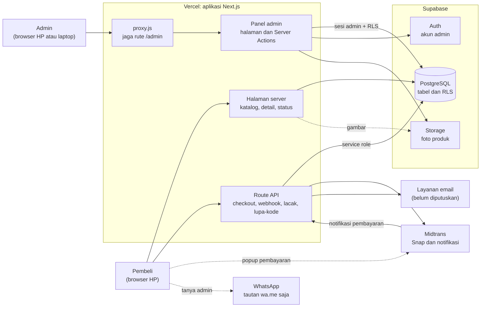
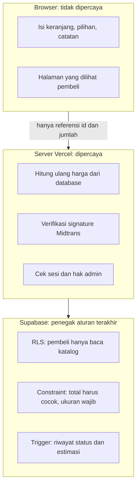
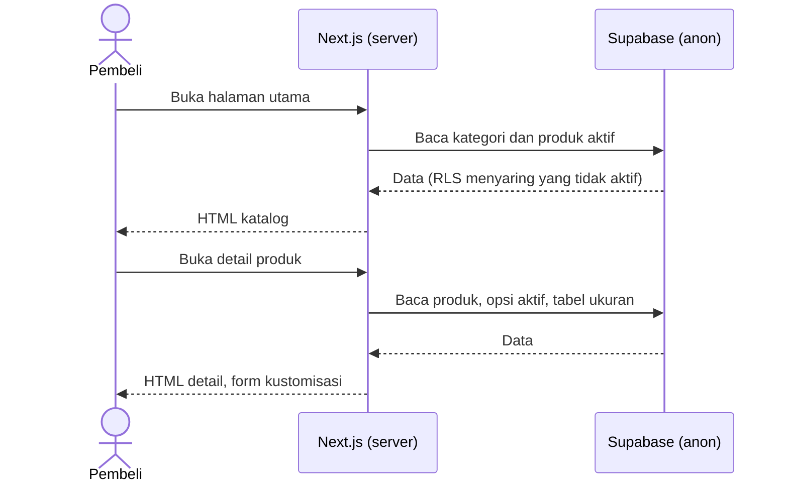
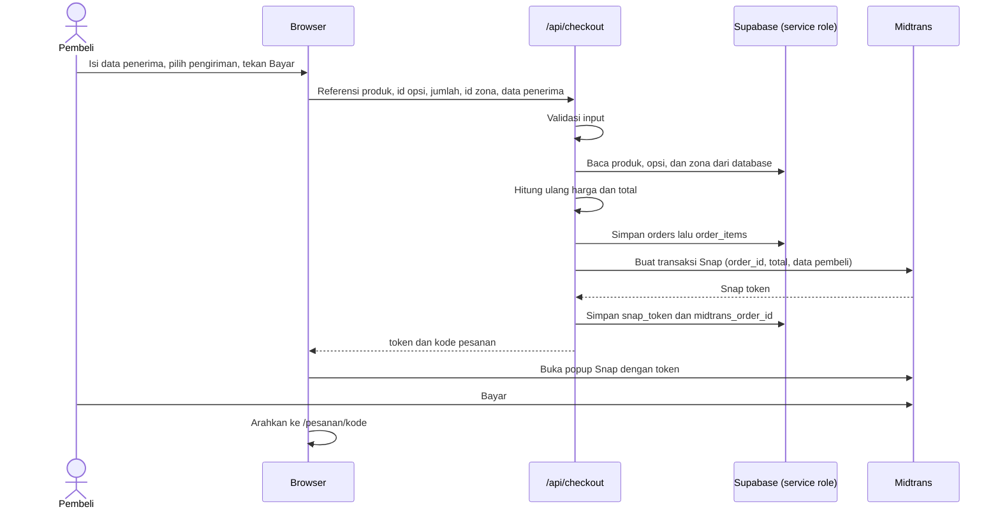
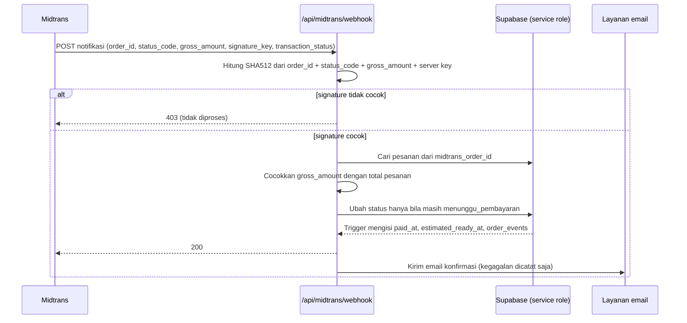
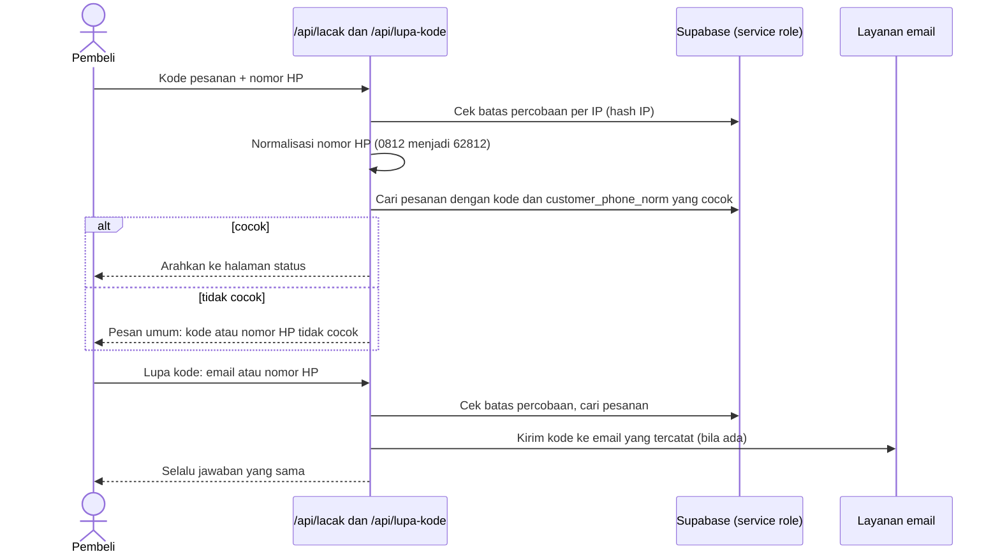
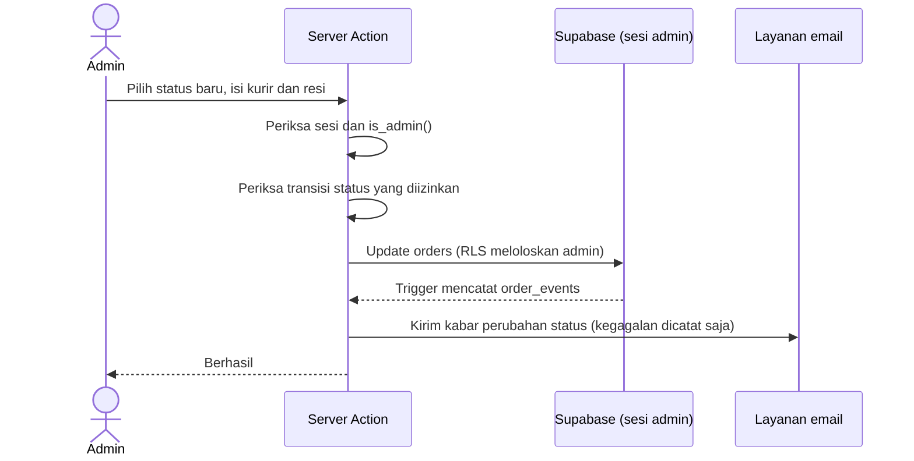
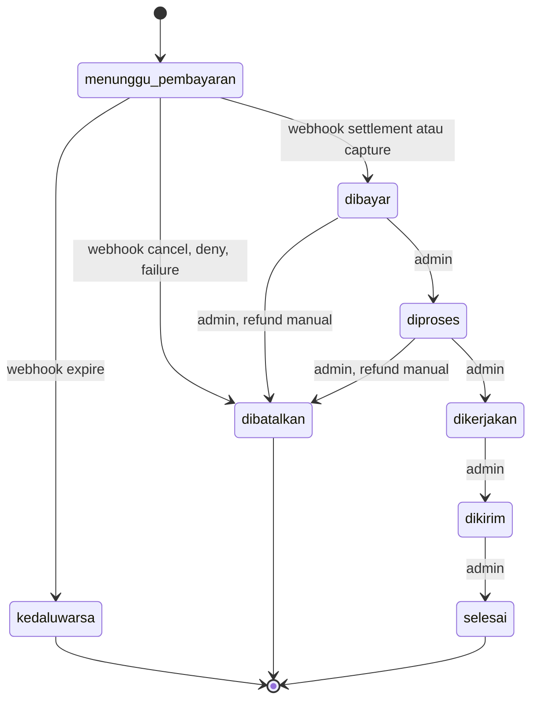

# Arsitektur: toko gamis pria custom

Dokumen pendamping [PRD E-commerce Gamis Pria Custom](https://claude.ai/code/artifact/c991434b-a24a-408c-ace2-dd505ef87448). Pilihan teknologi ada di `TECH_STACK.md`, struktur tabel di `DATABASE_SCHEMA.md`, dan tampilan di `UI_UX_SPEC.md`.

Terakhir diperbarui: 13 Oktober 2026.

Dokumen ini menjelaskan bagaimana bagian-bagian sistem bekerja sama: siapa memegang kunci apa, apa yang terjadi pada setiap alur penting, dan bagaimana sistem bertahan saat ada yang gagal. Fakta tentang Next.js, Midtrans, Supabase, dan Vercel diambil dari dokumentasi resmi masing-masing (lihat bagian Sumber); hal yang masih usulan ditandai sebagai usulan.

## 1. Gambaran sistem

Satu aplikasi Next.js di Vercel melayani halaman pembeli, panel admin, dan route API. Data, login admin, dan foto ada di Supabase. Pembayaran lewat Midtrans.



Garis putus-putus menunjukkan hubungan yang tidak melewati server kita. WhatsApp tidak memakai API: aplikasi hanya menyusun tautan `wa.me` berisi pesan siap kirim.

## 2. Komponen dan tanggung jawabnya

| Komponen | Tanggung jawab | Tidak boleh |
| --- | --- | --- |
| Halaman server (Server Components) | Membaca katalog, detail produk, dan status pesanan, lalu merender HTML | Menerima data harga dari browser |
| Komponen browser | Form kustomisasi, keranjang, tombol bayar (membuka Snap), pratinjau harga | Menjadi sumber kebenaran harga atau status |
| Route API publik | `/api/checkout`, `/api/midtrans/webhook`, `/api/lacak`, `/api/lupa-kode`: pekerjaan yang dipicu pembeli atau Midtrans | Mempercayai angka dari browser; mengembalikan data pribadi lengkap |
| Panel admin | Halaman dan Server Actions di `/admin`: pesanan, produk, ongkir | Berjalan tanpa memeriksa sesi admin |
| `proxy.js` | Menyegarkan sesi Supabase dan mengarahkan pengguna yang belum login dari `/admin` ke halaman login | Menjadi satu-satunya pemeriksaan hak akses |
| Supabase PostgreSQL | Menyimpan data dan menegakkan aturan akses lewat RLS, constraint, dan trigger | |
| Supabase Auth | Login akun admin | Dipakai untuk pembeli (checkout sebagai tamu) |
| Supabase Storage | Foto produk (bucket `product-photos`) | |
| Midtrans | Memproses pembayaran dan mengirim notifikasi hasilnya | |
| Layanan email | Konfirmasi pesanan, kabar perubahan status, kirim ulang kode | Memblokir alur pesanan bila gagal |

Catatan Next.js: sejak versi 16, berkas `middleware` berganti nama menjadi `proxy` dan berjalan di runtime Node.js. Proxy tidak boleh jadi satu-satunya penjaga: dokumentasi Next.js menegaskan bahwa Server Functions dipanggil sebagai POST ke rute tempat ia dipakai, sehingga rute yang dikecualikan matcher ikut melewati proxy. Karena itu **setiap Server Action admin memeriksa sesi dan hak admin sendiri**.

## 3. Batas kepercayaan dan kunci

Tiga cara mengakses Supabase, masing-masing dengan kekuatan berbeda:

| Cara akses | Kunci | Dipakai oleh | Kekuatan |
| --- | --- | --- | --- |
| Anon | `NEXT_PUBLIC_SUPABASE_ANON_KEY` | Halaman server untuk pembeli | Hanya membaca katalog aktif (RLS) |
| Sesi admin | Anon key + cookie sesi admin | Panel admin | Dibatasi RLS: hanya akun di tabel `admins` yang lolos `is_admin()` |
| Service role | `SUPABASE_SERVICE_ROLE_KEY` | Route API publik saja | Melewati semua RLS |

Keputusan: **panel admin memakai sesi admin di bawah RLS, bukan service role.** Dengan begitu kunci terkuat hanya hidup di empat route API publik, dan jika ada bug di panel admin, database tetap menolak siapa pun yang bukan admin. Untuk memeriksa hak admin di Server Action, panggil fungsi `is_admin()` lewat `rpc` memakai sesi pengguna (tabel `admins` sendiri tidak punya kebijakan baca).



## 4. Strategi render dan data

- **Halaman publik** (`/`, `/produk/[slug]`, `/pesanan/[kode]`, `/lacak`) dirender di server supaya HTML sudah berisi konten saat sampai di HP, sesuai target muat di bawah 3 detik pada 4G.
- **Katalog dan detail produk** jarang berubah, jadi hasilnya boleh di-cache dan harus diperbarui saat admin menyimpan perubahan produk, opsi, atau harga (Server Action admin memicu revalidasi). Mekanisme cache Next.js berubah antarversi, jadi cara persisnya dicek di dokumentasi versi yang terpasang saat membangun.
- **Status pesanan** tidak boleh di-cache: harus selalu menampilkan keadaan terbaru.
- **Komponen browser** hanya untuk interaksi: form kustomisasi (pilihan dan pratinjau harga lewat `lib/pricing.js`), keranjang di `localStorage`, dan tombol bayar yang memuat skrip Snap.
- **Foto produk** disajikan lewat `next/image` dari bucket publik Supabase. Domain Supabase didaftarkan di konfigurasi gambar Next.js.
- **Pratinjau harga di browser hanya tampilan.** Angka yang ditagih selalu hasil hitung ulang server (bagian 7).

## 5. Alur-alur utama

### 5.1 Melihat katalog dan detail produk



### 5.2 Checkout dan pembayaran



Langkah rinci di `/api/checkout` (urutan penting):

1. Validasi bentuk data (nama, nomor HP, email wajib dan valid, alamat, provinsi, jumlah bilangan bulat positif).
2. Muat produk, opsi, dan zona ongkir dari database berdasarkan id. Tolak bila produk atau opsi tidak aktif, bila opsi bukan milik produk itu, atau bila jenisnya tidak lengkap (tiap item wajib tepat satu ukuran, satu bahan, dan satu warna).
3. Hitung `unit_price` = `base_price` + jumlah `price_delta` opsi terpilih, `line_total` = `unit_price` × jumlah, `subtotal` = jumlah semua `line_total`, `total` = `subtotal` + ongkir zona.
4. Simpan `orders`, lalu `order_items` berisi salinan nama, harga, opsi, dan `lead_time_days`.
5. Minta Snap token ke Midtrans. `order_id` Midtrans memakai kode pesanan (`GM-…`). Ongkir dikirim sebagai satu baris item, karena Midtrans memeriksa bahwa jumlah `item_details` sama dengan `gross_amount`.
6. Simpan `snap_token` dan `midtrans_order_id`, lalu kembalikan token dan kode ke browser.

Satu pesanan hanya punya satu upaya pembayaran (kolom `midtrans_order_id` unik). Bila pembeli menutup popup, pesanan tetap `menunggu_pembayaran` dan ia bisa melanjutkan dari halaman status memakai token yang sama selama belum kedaluwarsa. Bila sudah kedaluwarsa, pembeli membuat pesanan baru.

### 5.3 Notifikasi pembayaran (webhook)



Aturan lengkap webhook ada di bagian 6.

### 5.4 Melacak pesanan dan lupa kode



Halaman `/pesanan/[kode]` sendiri dibuka hanya dengan kode (tautan dari email dan halaman konfirmasi). Kode berbentuk `GM-` diikuti 10 karakter acak, jadi sulit ditebak, dan halaman hanya menampilkan data yang perlu (bagian 8).

### 5.5 Admin mengubah status pesanan



Transisi status yang diizinkan dipaksakan di aplikasi (database tidak membatasinya):



Hanya webhook yang boleh membuat status menjadi `dibayar`. Admin tidak punya tombol untuk itu. Bila webhook terlambat, admin memakai tombol "Periksa status pembayaran" yang memanggil Status API Midtrans (lihat bagian 6).

## 6. Aturan webhook Midtrans

Bagian ini mengikuti dokumentasi Midtrans tentang notifikasi HTTP dan praktik terbaiknya.

**Verifikasi.** `signature_key` dihitung sebagai `SHA512(order_id + status_code + gross_amount + serverkey)`. Pakai nilai persis seperti string di badan notifikasi (jangan menghitung ulang `gross_amount` dari angka sendiri, karena formatnya bisa berbeda, misalnya dengan dua desimal), dan bandingkan dengan perbandingan waktu-konstan. Setelah itu cocokkan `gross_amount` dengan `orders.total` sebagai angka.

**Pemetaan status Midtrans ke status pesanan.** Perubahan hanya diterapkan bila pesanan masih `menunggu_pembayaran`.

| `transaction_status` | Syarat tambahan | Tindakan |
| --- | --- | --- |
| `settlement` | `status_code` 200 | `dibayar` |
| `capture` | `status_code` 200 dan `fraud_status` = `accept` | `dibayar` |
| `pending` | | Tidak ada perubahan |
| `expire` | | `kedaluwarsa` |
| `cancel`, `deny`, `failure` | | `dibatalkan` |
| `authorize` | | Tidak dipakai (pra-otorisasi bukan bawaan); dicatat |
| `refund`, `partial_refund`, `chargeback`, `partial_chargeback` | | Status pesanan tidak diubah otomatis; dicatat; admin menanganinya di dashboard Midtrans (di luar MVP) |

**Idempotensi dan urutan.** Midtrans bisa mengirim notifikasi yang sama lebih dari sekali, dan notifikasi bisa datang tidak berurutan (misalnya `settlement` sebelum `pending`). Pembaruan dibuat kondisional, sehingga duplikat dan notifikasi yang akan memundurkan status tidak berpengaruh:

```sql
update orders set status = 'dibayar'
where midtrans_order_id = $1 and status = 'menunggu_pembayaran';
```

Jika tidak ada baris yang berubah, tetap balas 200.

**Kasus anomali.** Dicatat ke log dan diberi tahukan ke admin, tanpa mengubah status otomatis:
- `gross_amount` tidak sama dengan `total` pesanan.
- Pesanan yang sudah `dibayar` menerima `deny`. Dokumentasi Midtrans menyebut `settlement` bisa langka berbalik menjadi `deny` dalam sekitar 1 sampai 5 menit untuk transfer Permata, tagihan Mandiri, dan Indomaret. Metode pembayaran yang aktif diatur di dashboard Midtrans, jadi aktifkan hanya metode yang siap Anda tangani.
- `order_id` tidak dikenal (misalnya notifikasi uji): balas 200 dan catat, supaya tidak diulang terus.

**Kode balasan.** Midtrans memilih perilaku ulangnya dari kode HTTP: 2xx dianggap sukses tanpa ulang; 500 diulang sekali; 503 empat kali; 400 dan 404 dua kali; kegagalan lain lima kali; 301, 302, 303 tidak diulang. Balas cepat (targetnya di bawah 5 detik) dan kembalikan 2xx untuk semua notifikasi yang valid, termasuk duplikat. Signature tidak cocok dijawab 403.

**Email setelah webhook.** Kirim email setelah status tersimpan, dan kegagalan email hanya dicatat, tidak membuat webhook gagal. Pastikan pengiriman tidak terpotong saat fungsi serverless selesai (gunakan mekanisme kerja-setelah-balasan Next.js atau kirim sebelum membalas bila cukup cepat).

**Jika notifikasi telat atau hilang.** Midtrans menyatakan notifikasi `settlement` biasanya tiba dalam sekitar 20 detik dan `expire` dalam sekitar 90 detik, dan menyarankan memakai Status API untuk status terbaru. Cadangan MVP: tombol "Periksa status pembayaran" di panel admin dan di halaman status pembeli (untuk pesanan `menunggu_pembayaran`), yang memanggil Status API lalu menerapkan pemetaan yang sama.

Alamat notifikasi (Payment Notification URL) diisi di dashboard Midtrans, terpisah untuk Sandbox dan Production, dan harus bisa dijangkau dari internet.

## 7. Penghitungan harga

`lib/pricing.js` dipakai di dua tempat dengan aturan yang sama:

| Tempat | Tujuan | Sifat |
| --- | --- | --- |
| Browser (form kustomisasi, keranjang) | Menampilkan harga langsung saat pilihan berubah | Hanya tampilan |
| `/api/checkout` | Menentukan jumlah yang ditagih | Sumber kebenaran |

Rumus: `unit_price` = `base_price` + jumlah `price_delta` opsi terpilih; `line_total` = `unit_price` × jumlah; `total` = jumlah semua `line_total` + ongkir zona. Semua bilangan bulat rupiah.

Bila total hasil server berbeda dengan yang dilihat pembeli (misalnya admin mengganti harga saat pembeli mengisi checkout), server mengembalikan kondisi "harga berubah" beserta total baru, dan antarmuka meminta pembeli menyetujui sebelum membayar. Server tidak diam-diam menagih angka lain.

Database ikut menjaga konsistensi: constraint `orders_total_matches` (`total` = `subtotal` + `shipping_fee`) dan `order_items_line_matches` (`line_total` = `unit_price` × `quantity`) menolak data yang tidak cocok, walau tidak bisa memeriksa kebenaran harga terhadap katalog.

## 8. Keamanan

| Ancaman | Mitigasi |
| --- | --- |
| Pembeli memanipulasi harga lewat browser | Harga dihitung ulang di server dari database; browser hanya mengirim id dan jumlah |
| Notifikasi pembayaran palsu | Verifikasi signature SHA512 dengan server key; hanya webhook yang bisa membuat status `dibayar`; `gross_amount` dicocokkan dengan total |
| Menebak kode pesanan orang lain | Kode `GM-` + 10 karakter acak; `/lacak` wajib kode dan nomor HP yang cocok; halaman status hanya menampilkan data terbatas |
| Percobaan beruntun pada `/lacak` dan `/lupa-kode` | Batas percobaan per IP lewat `lookup_attempts` (hanya hash IP disimpan). Angka awal usulan: `/lacak` 10 kali dan `/lupa-kode` 3 kali per 15 menit per IP |
| Mengetahui apakah sebuah nomor atau email pernah memesan | Jawaban `/lupa-kode` selalu sama; kesalahan `/lacak` memakai pesan umum |
| Admin palsu atau akses tanpa login | Login Supabase Auth, pendaftaran publik dimatikan, `proxy.js`, pemeriksaan sesi dan `is_admin()` di setiap Server Action, dan RLS di database |
| Kunci rahasia bocor ke browser | Hanya variabel `NEXT_PUBLIC_*` yang terkirim ke browser; `SUPABASE_SERVICE_ROLE_KEY`, `MIDTRANS_SERVER_KEY`, `RESEND_API_KEY`, dan `IP_HASH_SALT` hanya di server |
| Akses data pesanan langsung dari browser | RLS aktif dan hak `anon` atas tabel pesanan dicabut |
| Skrip jahat lewat catatan atau nama | Teks ditampilkan sebagai teks oleh React (tidak pernah sebagai HTML mentah); input divalidasi di server |
| Injeksi SQL | Semua akses lewat klien Supabase (kueri berparameter); tidak ada SQL yang dirangkai dari input |
| Berkas berbahaya di bucket foto | Hanya admin yang boleh mengunggah; batas 2 MB; hanya JPEG, PNG, WebP |
| Data pembayaran pembeli | Tidak pernah menyentuh server kita; kartu dan rekening ditangani Midtrans |

Bila nanti memasang Content Security Policy, izinkan skrip Snap Midtrans (sandbox dan production berada di domain berbeda).

**Celah yang diketahui dan diterima untuk MVP:**
- `/lupa-kode` tidak punya batas per alamat email, jadi pihak lain bisa memicu banyak email ke satu alamat dari banyak IP. Perbaikan: tambah kolom `target_hash` di `lookup_attempts`.
- `/api/checkout` belum punya pembatasan, jadi pesanan `menunggu_pembayaran` bisa menumpuk karena spam. Perbaikan: perluas nilai `kind` di `lookup_attempts` atau pakai perlindungan bot dari platform.
- `/pesanan/[kode]` tidak punya batas percobaan per IP. Risikonya kecil karena ruang kode sangat besar.

## 9. Penanganan kegagalan

| Kegagalan | Dampak | Penanganan |
| --- | --- | --- |
| Penyimpanan `order_items` gagal setelah `orders` tersimpan | Pesanan tanpa item | Hapus pesanan yang baru dibuat dan kembalikan galat. Perbaikan lebih kuat: satu fungsi Postgres `create_order` yang memasukkan keduanya dalam satu transaksi |
| Midtrans tidak merespons saat membuat transaksi | Pesanan tanpa token | Tandai `dibatalkan` seketika dan minta pembeli mencoba lagi |
| Pembeli menutup popup Snap | Pesanan menggantung | Tetap `menunggu_pembayaran`; halaman status menawarkan "Bayar sekarang" selama belum kedaluwarsa |
| Webhook terlambat atau hilang | Status tertahan | Tombol "Periksa status pembayaran" memanggil Status API |
| Email gagal terkirim | Pembeli tidak menerima kode | Dicatat di log; kode tetap tampil di halaman konfirmasi; admin bisa mengirim tautan lewat WhatsApp |
| Supabase gratis dijeda atau tidak tersedia | Situs dan checkout gagal | Halaman galat yang jelas; pada produksi pakai paket Pro (tidak pernah dijeda) |
| Penerapan gagal atau ada bug setelah rilis | Layanan terganggu | Terapkan ulang penerapan sebelumnya dari dashboard Vercel; perubahan SQL bersifat manual, jadi simpan salinan skema sebelum mengubahnya |

## 10. Lingkungan dan penerapan

| | Pengembangan | Pratinjau (cabang/PR) | Produksi |
| --- | --- | --- | --- |
| Hosting | Lokal (`npm run dev`) | Vercel Preview | Vercel Production |
| Database | Proyek Supabase terpisah (paket gratis) | Memakai database pengembangan | Proyek Supabase produksi |
| Midtrans | Sandbox | Sandbox | Production |
| Variabel lingkungan | `.env.local` | Pengaturan Vercel (Preview) | Pengaturan Vercel (Production) |

Dua proyek aktif di paket gratis Supabase cukup untuk memisahkan pengembangan dan produksi. Sandbox dan Production Midtrans punya kunci dan alamat notifikasi sendiri-sendiri.

Alur penerapan: dorong kode ke GitHub, Vercel membangun dan menerapkan otomatis. Perubahan skema database dijalankan manual di SQL Editor (tanpa alat migrasi untuk MVP), jadi simpan setiap perubahan sebagai berkas SQL bernomor di folder `supabase/`.

**Biaya hosting yang perlu diketahui.** Menurut [panduan penggunaan wajar Vercel](https://vercel.com/docs/limits/fair-use-guidelines) (diperbarui 14 September 2026), paket Hobby hanya untuk penggunaan pribadi non-komersial, dan "metode apa pun untuk meminta atau memproses pembayaran dari pengunjung situs" tergolong komersial yang mewajibkan paket Pro atau Enterprise. Toko ini menerima pembayaran, jadi untuk produksi perlu Vercel Pro. Halaman harga Vercel mencantumkan Pro $20 per bulan (halaman itu tidak jelas apakah harga mencakup satu kursi pengembang atau lebih). Bila Supabase juga Pro ($25 per bulan, agar tidak dijeda dan ada backup), perkiraan biaya bulanan sekitar $45 sebelum biaya domain. Cek harga terkini sebelum memutuskan, dan tanyakan ke dukungan Vercel bila ragu apakah tahap pengembangan juga termasuk komersial. Apakah region fungsi Singapura (sin1) bisa dipilih untuk paket Anda belum terverifikasi; cek di dashboard.

## 11. Observabilitas dan operasi

- **Log:** pakai log Vercel. Catat id pesanan, transisi status, hasil verifikasi webhook, dan kode galat. Jangan mencatat server key, token Snap, atau data pribadi lengkap (alamat, email, nomor HP).
- **Pemantauan:** pasang pemantau uptime eksternal pada halaman utama dan `/api/health` (rute sederhana yang membaca satu baris dari database). Ini sekaligus menjaga proyek Supabase gratis tidak dijeda selama masa pengembangan.
- **Backup:** paket gratis Supabase tidak punya backup otomatis, jadi ekspor database berkala (`pg_dump` atau ekspor dari dashboard), terutama sebelum mengubah skema. Paket Pro menyimpan backup harian selama 7 hari.
- **Pembersihan:** hapus baris `lookup_attempts` yang lebih tua dari sehari secara berkala.
- **Uang masuk:** cocokkan pesanan `dibayar` dengan laporan di dashboard Midtrans secara berkala, terutama pada minggu pertama.

## 12. Batas kapasitas

Untuk puluhan sampai ratusan pesanan per bulan, beban sangat kecil dan batas paket gratis Supabase (500 MB database, 1 GB file, 5 GB egress; data per 12 Oktober 2026) cukup dari sisi ukuran. Pembatas yang sebenarnya adalah kebijakan, bukan kapasitas: jeda otomatis dan tanpa backup di Supabase gratis, serta larangan penggunaan komersial di Vercel Hobby. Foto produk adalah pemakai penyimpanan dan egress terbesar, jadi kompres sebelum diunggah.

## 13. Keputusan arsitektur

| Keputusan | Alasan | Konsekuensi |
| --- | --- | --- |
| Satu aplikasi Next.js (monolit) untuk pembeli, admin, dan API | Dikerjakan seorang diri dalam 7 hari; satu proyek, satu bahasa | Batas antar bagian dijaga oleh disiplin kode dan RLS, bukan oleh pemisahan layanan |
| Checkout sebagai tamu, tanpa akun pembeli | Mengurangi hambatan membeli; sesuai ruang lingkup MVP | Pelacakan lewat kode dan nomor HP, bukan riwayat akun |
| Harga dihitung ulang di server | Browser tidak dipercaya | Pratinjau harga dan harga tagihan memakai kode yang sama (`lib/pricing.js`) |
| Hanya webhook yang membuat pesanan `dibayar` | Mencegah pembeli atau admin salah menandai lunas | Perlu cadangan lewat Status API bila notifikasi telat |
| Salinan nama, harga, dan zona di pesanan | Pesanan lama tidak berubah saat katalog diubah | Data sedikit berulang, disengaja |
| Tabel pesanan tertutup dari browser; admin memakai sesi di bawah RLS | Kunci service role hanya di empat route API | Perlu pemeriksaan `is_admin()` di setiap Server Action |
| Satu upaya pembayaran per pesanan | Sederhana dan sesuai kolom unik `midtrans_order_id` | Pesanan kedaluwarsa tidak bisa dibayar ulang; pembeli memesan lagi |
| Resi dan status pengiriman diisi manual | API kurir ditunda ke versi 2 | Admin yang mengabari; ada tombol WhatsApp |
| Tanpa antrean atau layanan latar | Volume kecil | Email dikirim langsung setelah perubahan tersimpan |

## 14. Pertanyaan terbuka

| Hal | Keterangan |
| --- | --- |
| Pengirim email | Belum diputuskan. Domain `*.vercel.app` tidak bisa dipakai di Resend; pilihannya domain milik sendiri atau SMTP Gmail. Lihat `TECH_STACK.md` |
| Paket Vercel dan biaya | Produksi memerlukan Vercel Pro (bagian 10). Perlu keputusan anggaran |
| Pemetaan provinsi ke zona ongkir | Belum ada di database. Untuk MVP pembeli memilih zona sendiri dan admin memeriksa kecocokan dengan alamat saat memproses |
| Pembuatan pesanan atomik | Saat ini kompensasi (hapus bila gagal). Fungsi `create_order` di database lebih kuat dan bisa ditambahkan ke `schema.sql` |
| Catatan notifikasi mentah | Belum ada tabel untuk menyimpan isi notifikasi Midtrans; untuk MVP cukup log. Tabel `payment_notifications` berguna bila perlu menelusuri sengketa |

## Sumber

- [Next.js: proxy.js](https://nextjs.org/docs/app/api-reference/file-conventions/proxy) (dokumentasi versi 16.4.0, diperbarui 4 September 2026)
- [Midtrans: Handle notifications](https://docs.midtrans.com/reference/handle-notifications) dan [Best practices to handle notification](https://docs.midtrans.com/reference/best-practices-to-handle-notification)
- [Midtrans: Transaction status cycle](https://docs.midtrans.com/docs/transaction-status-cycle)
- [Vercel: Fair use guidelines](https://vercel.com/docs/limits/fair-use-guidelines) dan [Vercel: Pricing](https://vercel.com/pricing)
- [Supabase: Pricing](https://supabase.com/pricing)
