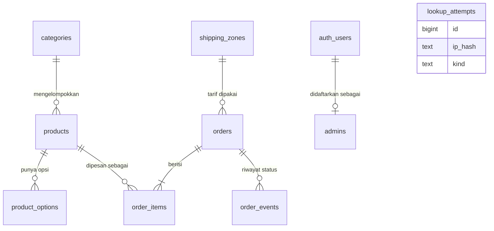

# Skema database: toko gamis pria custom

Dokumen pendamping [PRD E-commerce Gamis Pria Custom](https://claude.ai/code/artifact/c991434b-a24a-408c-ace2-dd505ef87448). Stack lengkap ada di `TECH_STACK.md`.

Terakhir diperbarui: 13 Oktober 2026. Sumber kebenaran tetap `schema.sql`; dokumen ini menjelaskannya.

Platform: Supabase (PostgreSQL). Semua harga disimpan sebagai bilangan bulat dalam rupiah. Semua `id` berupa UUID, kecuali `lookup_attempts` yang memakai angka berurutan.

## 1. Hubungan antartabel



`lookup_attempts` berdiri sendiri (tidak punya relasi). `auth_users` adalah tabel `auth.users` milik Supabase Auth.

Relasi ke `categories`, `shipping_zones`, dan `products` memakai `on delete set null`, supaya menghapus data katalog tidak ikut menghapus pesanan lama. Karena itu `orders` dan `order_items` menyalin nama, harga, dan zona saat dipesan.

## 2. Tipe enum

| Enum | Nilai |
| --- | --- |
| `option_type` | `ukuran`, `bahan`, `warna` |
| `shipping_method` | `antar_langsung`, `kurir_darat` |
| `order_status` | `menunggu_pembayaran`, `dibayar`, `diproses`, `dikerjakan`, `dikirim`, `selesai`, `kedaluwarsa`, `dibatalkan` |

## 3. Tabel katalog

### `categories`

| Kolom | Tipe | Keterangan |
| --- | --- | --- |
| `id` | uuid | Kunci utama |
| `name` | text | Wajib |
| `slug` | text | Wajib, unik |
| `sort_order` | integer | Default 0 |
| `is_active` | boolean | Default true |
| `created_at` | timestamptz | Default `now()` |

### `products`

| Kolom | Tipe | Keterangan |
| --- | --- | --- |
| `id` | uuid | Kunci utama |
| `category_id` | uuid | Merujuk `categories`, boleh kosong |
| `slug` | text | Wajib, unik; dipakai di URL `/produk/[slug]` |
| `name` | text | Wajib |
| `description` | text | Deskripsi produk |
| `material_info` | text | Keterangan bahan |
| `base_price` | integer | Wajib, minimal 0. Harga untuk ukuran dan bahan standar |
| `photos` | text[] | Daftar path foto di bucket `product-photos`; foto pertama adalah foto utama |
| `size_chart` | jsonb | Tabel ukuran, contoh `[{"ukuran":"M","lingkar_dada_cm":104,"panjang_cm":135}]` |
| `lead_time_days` | integer | Lama pengerjaan, harus lebih dari 0, default 7 |
| `is_active` | boolean | Default true |
| `created_at`, `updated_at` | timestamptz | `updated_at` diperbarui otomatis oleh trigger |

### `product_options`

Pilihan kustomisasi per produk. Harga akhir satu gamis = `base_price` + jumlah `price_delta` dari opsi yang dipilih.

| Kolom | Tipe | Keterangan |
| --- | --- | --- |
| `id` | uuid | Kunci utama |
| `product_id` | uuid | Wajib, merujuk `products`, ikut terhapus bila produk dihapus |
| `type` | option_type | `ukuran`, `bahan`, atau `warna` |
| `name` | text | Contoh: `XL`, `Katun Jepang`, `Hitam` |
| `price_delta` | integer | Tambahan harga, minimal 0, default 0 |
| `swatch_hex` | text | Kode warna `#RRGGBB` untuk swatch bulat; hanya relevan untuk `warna` |
| `sort_order` | integer | Urutan tampil, default 0 |
| `is_active` | boolean | Default true |
| `created_at` | timestamptz | Default `now()` |

Unik per kombinasi `(product_id, type, name)`.

### `shipping_zones`

Tarif ongkir tetap per wilayah, khusus Pulau Jawa, diatur admin.

| Kolom | Tipe | Keterangan |
| --- | --- | --- |
| `id` | uuid | Kunci utama |
| `name` | text | Contoh: `Jabodetabek`, `Jawa Tengah` |
| `method` | shipping_method | `antar_langsung` atau `kurir_darat` |
| `fee` | integer | Ongkir dalam rupiah, minimal 0 |
| `sort_order` | integer | Default 0 |
| `is_active` | boolean | Default true |
| `created_at` | timestamptz | Default `now()` |

Unik per kombinasi `(name, method)`.

## 4. Tabel pesanan

### `orders`

| Kolom | Tipe | Keterangan |
| --- | --- | --- |
| `id` | uuid | Kunci utama |
| `code` | text | Kode publik di `/pesanan/[kode]`, unik, otomatis berbentuk `GM-` diikuti 10 karakter acak |
| `status` | order_status | Default `menunggu_pembayaran` |
| `customer_name` | text | Wajib |
| `customer_phone` | text | Wajib, 8 sampai 20 karakter, sesuai input pembeli |
| `customer_phone_norm` | text | Kolom turunan otomatis: hanya angka, awalan `0` diganti `62` (`0812…` dan `+62 812…` menjadi `62812…`) |
| `customer_email` | text | **Wajib** dan formatnya dicek (constraint `orders_email_format`) |
| `address`, `city`, `province` | text | Wajib |
| `postal_code`, `note` | text | Opsional |
| `shipping_zone_id` | uuid | Merujuk `shipping_zones`, boleh kosong bila zona dihapus |
| `shipping_zone` | text | Wajib, salinan nama zona saat dipesan |
| `shipping_method` | shipping_method | Wajib |
| `courier` | text | Contoh JNE, J&T; diisi admin |
| `tracking_number` | text | Nomor resi, diisi admin manual |
| `subtotal`, `shipping_fee`, `total` | integer | Wajib, minimal 0. Constraint `orders_total_matches`: `total = subtotal + shipping_fee` |
| `midtrans_order_id` | text | Unik |
| `snap_token`, `payment_type` | text | Dari Midtrans |
| `paid_at` | timestamptz | Waktu pembayaran diterima |
| `estimated_ready_at` | timestamptz | Estimasi selesai dikerjakan, diisi trigger saat dibayar |
| `created_at`, `updated_at` | timestamptz | `updated_at` diperbarui otomatis |

### `order_items`

Salinan data saat dipesan, sehingga pesanan lama tidak berubah ketika admin mengganti harga atau menghapus produk.

| Kolom | Tipe | Keterangan |
| --- | --- | --- |
| `id` | uuid | Kunci utama |
| `order_id` | uuid | Wajib, ikut terhapus bila pesanan dihapus |
| `product_id` | uuid | Merujuk `products`, boleh kosong |
| `product_name` | text | Wajib, salinan |
| `base_price` | integer | Wajib, salinan |
| `size`, `material`, `color` | text | **Wajib semua**; database menolak pesanan tanpa data ukuran (metrik "data ukuran lengkap 100%") |
| `options` | jsonb | Rincian opsi terpilih, contoh `[{"type":"bahan","name":"Toyobo","price_delta":25000}]` |
| `custom_note` | text | Catatan kustomisasi pembeli |
| `lead_time_days` | integer | Salinan lama pengerjaan, lebih dari 0, default 7; dasar hitung estimasi selesai |
| `quantity` | integer | Lebih dari 0 |
| `unit_price`, `line_total` | integer | Constraint `order_items_line_matches`: `line_total = unit_price * quantity` |
| `created_at` | timestamptz | Default `now()` |

### `order_events`

Riwayat setiap perubahan status. Terisi otomatis oleh trigger dan menjadi sumber linimasa di halaman status pembeli.

| Kolom | Tipe | Keterangan |
| --- | --- | --- |
| `id` | uuid | Kunci utama |
| `order_id` | uuid | Wajib, ikut terhapus bila pesanan dihapus |
| `status` | order_status | Status yang baru |
| `created_at` | timestamptz | Waktu perubahan |

## 5. Tabel pendukung

### `admins`

| Kolom | Tipe | Keterangan |
| --- | --- | --- |
| `user_id` | uuid | Kunci utama, merujuk `auth.users`, ikut terhapus bila akun dihapus |
| `created_at` | timestamptz | Default `now()` |

Akun admin dibuat lewat Supabase Auth, lalu didaftarkan di tabel ini. Fungsi `is_admin()` memeriksa apakah pengguna yang sedang login ada di sini.

### `lookup_attempts`

Catatan percobaan `/lacak` dan `/lupa-kode` untuk pembatasan per IP.

| Kolom | Tipe | Keterangan |
| --- | --- | --- |
| `id` | bigint | Kunci utama, nomor berurutan otomatis |
| `ip_hash` | text | Hash IP (bukan IP asli) |
| `kind` | text | `lacak` atau `lupa_kode` |
| `created_at` | timestamptz | Default `now()` |

Route API menolak bila terlalu banyak percobaan dalam 15 menit. Tabel ini terus bertambah, jadi hapus baris yang lebih tua dari sehari secara berkala, misalnya `delete from lookup_attempts where created_at < now() - interval '1 day';`.

## 6. Fungsi dan trigger

| Nama | Jenis | Fungsinya |
| --- | --- | --- |
| `set_updated_at()` | Fungsi + trigger pada `products` dan `orders` | Memperbarui `updated_at` setiap ada perubahan baris |
| `log_order_status()` | Fungsi + trigger `trg_orders_status_log` | Mencatat status awal dan setiap perubahan status ke `order_events` |
| `set_estimated_ready()` | Fungsi + trigger `trg_orders_estimate_ready` | Saat status berubah menjadi `dibayar`: mengisi `paid_at` (bila kosong) dan `estimated_ready_at` = waktu bayar + `lead_time_days` terbesar di `order_items` pesanan itu (default 7 hari bila tidak ada item) |
| `is_admin()` | Fungsi | Mengembalikan true bila pengguna login terdaftar di `admins` |

Catatan penting: trigger estimasi membaca `order_items`, jadi item pesanan harus sudah tersimpan **sebelum** status diubah menjadi `dibayar`. Route checkout menyimpan `orders` dan `order_items` lebih dulu, baru webhook mengubah status.

## 7. Indeks

| Indeks | Tabel dan kolom | Untuk |
| --- | --- | --- |
| `idx_products_category` | `products (category_id)` | Filter kategori |
| `idx_products_active` | `products (is_active)` | Katalog aktif |
| `idx_product_options_prod` | `product_options (product_id, type, sort_order)` | Memuat opsi di form kustomisasi |
| `idx_orders_status_created` | `orders (status, created_at desc)` | Daftar pesanan di panel admin |
| `idx_order_items_order` | `order_items (order_id)` | Item per pesanan |
| `idx_order_events_order` | `order_events (order_id, created_at)` | Linimasa status |
| `idx_orders_phone_norm` | `orders (customer_phone_norm)` | `/lacak` dan pencarian admin |
| `idx_orders_email_lower` | `orders (lower(customer_email))` | `/lupa-kode` |
| `idx_orders_name_lower` | `orders (lower(customer_name))` | Pencarian admin |
| `idx_lookup_attempts_recent` | `lookup_attempts (ip_hash, kind, created_at desc)` | Pembatasan percobaan |

## 8. Aturan akses (Row Level Security)

Semua tabel mengaktifkan RLS. Route API memakai service role key yang melewati RLS, jadi pembeli tidak pernah menyentuh tabel pesanan langsung dari browser.

| Tabel | Pembeli (anon) | Admin (login + terdaftar di `admins`) | Route API (service role) |
| --- | --- | --- | --- |
| `categories`, `products` | Baca yang `is_active` | Baca dan ubah semua | Semua |
| `product_options` | Baca yang `is_active` dan produknya aktif | Baca dan ubah semua | Semua |
| `shipping_zones` | Baca yang `is_active` | Baca dan ubah semua | Semua |
| `orders`, `order_items`, `order_events` | **Tidak ada akses** | Baca dan ubah semua | Semua |
| `admins` | Tidak ada akses | Tidak ada kebijakan langsung (dicek lewat `is_admin()`) | Semua |
| `lookup_attempts` | Tidak ada akses | Tidak ada akses | Semua |

Hak `anon` atas `orders`, `order_items`, `order_events`, dan `admins` juga dicabut (`revoke all`) sebagai lapisan pengaman kedua. Hak `anon` dan `authenticated` atas `lookup_attempts` dicabut seluruhnya.

## 9. Penyimpanan foto produk

Bucket Supabase Storage `product-photos`:

- Publik: foto bisa dibaca siapa saja.
- Hanya admin yang boleh mengunggah, mengubah, dan menghapus.
- Batas 2 MB per berkas, hanya `image/jpeg`, `image/png`, dan `image/webp`.
- Kolom `products.photos` menyimpan path berkas di bucket ini.

## 10. Data contoh (`seed.sql`)

Dijalankan setelah `schema.sql`. Aman dijalankan ulang (`on conflict do nothing`), jadi harga yang sudah diubah lewat panel admin tidak tertimpa.

| Data | Jumlah |
| --- | --- |
| Kategori (Gamis Harian, Gamis Acara, Gamis Seragam) | 3 |
| Produk, harga dasar Rp275.000–650.000, pengerjaan 7–14 hari | 8 |
| Opsi ukuran (S–XL tanpa tambahan, XXL +Rp15.000, XXXL +Rp25.000) | 48 (6 × 8 produk) |
| Opsi bahan (2–3 per produk, bahan standar tambahan 0) | 18 |
| Opsi warna (6 per produk, tanpa tambahan harga) | 48 |
| Zona ongkir: 1 antar langsung, 6 kurir darat di Pulau Jawa | 7 |

Semuanya **data contoh**. Ganti sebelum rilis lewat panel admin: harga dan deskripsi produk, tambahan harga bahan dan ukuran, tabel ukuran, tarif ongkir, dan nama zona antar langsung. Foto produk sengaja kosong (`photos` = array kosong), jadi tampilan perlu gambar pengganti sampai foto diunggah.

## 11. Cara memasang

1. Buka Supabase Dashboard, **SQL Editor**, tempel seluruh `schema.sql`, lalu **Run**.
2. Tempel seluruh `seed.sql`, lalu **Run**. Hasil akhirnya menampilkan jumlah data (3 kategori, 8 produk, 48 opsi ukuran, 18 opsi bahan, 48 opsi warna, 7 zona).
3. Buat akun admin: **Authentication > Users > Add user**, isi email dan kata sandi kuat, centang Auto Confirm User.
4. Daftarkan akun itu sebagai admin (ganti emailnya):
   ```sql
   insert into admins (user_id)
   select id from auth.users where email = 'GANTI_DENGAN_EMAIL_ADMIN'
   on conflict do nothing;
   ```
5. Matikan pendaftaran publik: **Authentication > Sign In / Providers**, matikan "Allow new users to sign up", supaya hanya akun buatan Anda yang bisa login.

## 12. Catatan migrasi

- `schema.sql` aman dijalankan ulang untuk enum, fungsi, trigger, kebijakan, dan bucket. Tabel memakai `create table if not exists`, jadi perubahan kolom di masa depan harus dibuat sebagai migrasi terpisah (`alter table`).
- Bagian 4b di `schema.sql` memigrasikan database yang terlanjur memakai versi pertama (menambah `customer_phone_norm`, `estimated_ready_at`, `lead_time_days`, dan constraint email). Pada database baru, bagian itu tidak mengubah apa pun.
- Jika sudah ada pesanan lama tanpa email, isi dulu sebelum menjalankan versi 2, misalnya `update orders set customer_email = 'tidak-ada@example.invalid' where customer_email is null;`.

## 13. Status pengujian

`schema.sql` dan `seed.sql` sudah dijalankan masing-masing dua kali di PostgreSQL 16 lokal tanpa kesalahan, dengan jumlah data yang sama setelah dijalankan ulang. Yang ikut terbukti: kode pesanan terbentuk dengan benar, nomor HP berformat berbeda menjadi nilai ternormalisasi yang sama, email kosong atau salah format ditolak, estimasi selesai terisi saat dibayar (14 hari untuk pesanan berisi item 7 dan 14 hari), dan `order_events` mencatat tiap perubahan status.

Belum teruji di Supabase sungguhan. Di PostgreSQL lokal, Auth dan Storage hanya ditiru secara sederhana, jadi kebijakan RLS, fungsi `is_admin()` dengan sesi login nyata, dan bucket foto perlu dicoba langsung setelah dipasang.
